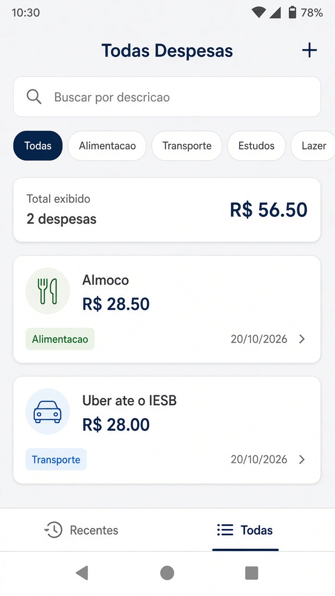
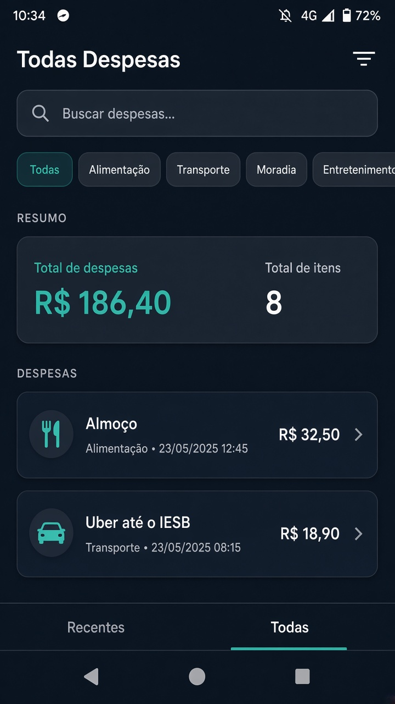
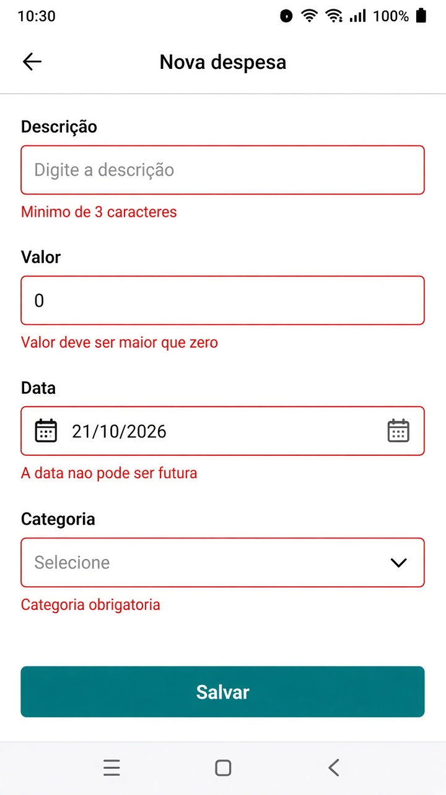

# Gerenciador de Despesas 2.0

App Expo com estado global, persistencia local, criacao/edicao na mesma tela, validacao de formulario, busca e tema do sistema.

## Como rodar

```bash
npm install
npx expo start
```

## Requisitos

- Context API + useReducer (`ADD`, `UPDATE`, `DELETE`, `SET`) em `src/store/expenses-context.js`
- Persistencia AsyncStorage na chave `@expenses`
- Modelo `{ id, description, amount, date, category }`
- Uma tela para criar e editar (`route.params.expenseId`)
- Validacao por campo, Modal de categoria e KeyboardAvoidingView
- Busca com `useDebounce` + `useMemo`
- Tema claro/escuro em `src/constants/theme.js`

## Prints







## Bonus

- Filtro por categoria
- Limpar tudo com confirmacao
- 2 colunas quando a largura for maior que 600
